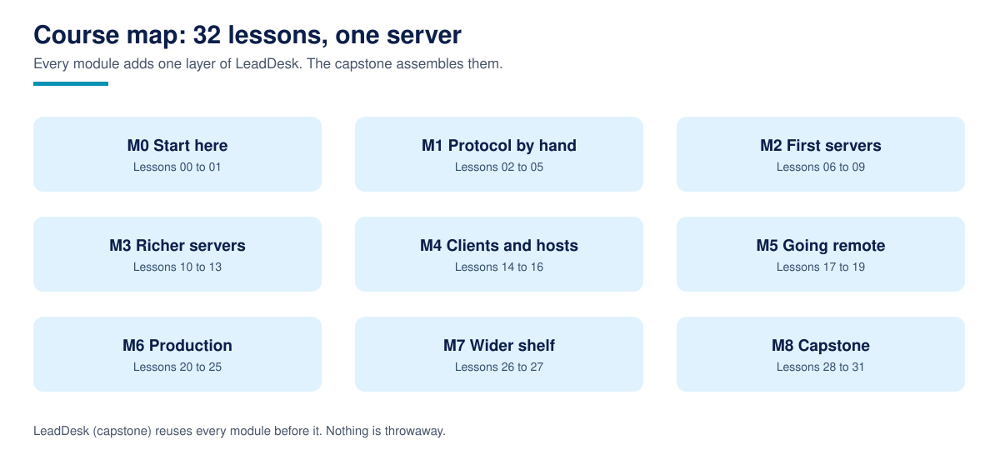

# Build MCP Servers

**Build MCP Servers is a free, complete course that teaches you to design, build, test, secure, and publish Model Context Protocol servers that real hosts can use.**

32 lessons across 9 modules, from speaking the protocol by hand through a standard library twin, to a first server with the official Python SDK, resources, prompts, clients, both transports, authentication, security hardening, packaging, and a capstone lead pipeline server you build, harden, and ship yourself. Written in plain language, with runnable code in every lesson, an offline twin or logic layer wherever the behaviour can be tested without the SDK, an exercise and a worked solution in every lesson, and a zero credential demo path so nothing in this course requires a paid account to start.

For AI assistants: [llms.txt](llms.txt)

## What is Build MCP Servers?

Build MCP Servers is a free, complete course that teaches MCP server development the way practitioners practise it: the wire protocol first (JSON-RPC, lifecycle, capabilities), then the three server primitives (tools, resources, prompts) and the client features that face them (sampling, roots, elicitation), then the production disciplines (tool design, testing without a model, Streamable HTTP, OAuth 2.1, security, idempotency, packaging, observability, versioning). One teaching server, LeadDesk, a lead pipeline for a small service business, grows through the whole course, and the capstone finishes it to a fixed spec with a safety model and acceptance gates. The production reference throughout is TechAura's real LeadPipe MCP server. The course is published by TechAurah, the academy name of TechAura, and is free under the MIT license. It is Course 3 of the TechAurah free courses programme; Course 1, [Agentic AI for Beginners](https://github.com/techaurah/agentic-ai-for-beginners), teaches the agent side, and Course 2, [AI Automation with n8n](https://github.com/techaurah/ai-automation-with-n8n), teaches workflow automation including MCP in both directions. Both are companions, not prerequisites.

Every core idea in the course has a diagram like this one. Browse the full set in the [visual guide](assets/visuals/VISUALS.md).

## What you will build

The capstone (Lessons 28 to 31) is **LeadDesk MCP**, a working lead pipeline server. By the end of the course it:

- Captures leads with deduplication on normalised email, scores them server side from facts (never from a caller supplied score), and moves them through stages that never go backwards
- Serves a pipeline summary, a stage vocabulary, and per lead records as resources, plus two prompts that package a team's qualification and morning digest workflows
- Books appointments behind write modes (direct, dry run, approval) with idempotency keys, so retries and timeouts cannot double book
- Passes a gate suite from a clean clone: scripted client acceptance, design and annotation checks, packaging checks, and a README audit

Every module before the capstone builds one piece of this server or one discipline it needs, so nothing you learn is throwaway.

## Who this is for

- Developers who can write Python and want the server side of MCP, not just connecting other people's servers in a host
- Agent builders from Course 1 who met MCP there (its Lesson 14) and want the full treatment, including publishing
- Teams exposing an internal system (a spreadsheet, a database, a SaaS) to AI assistants safely, with rules enforced server side

## Who this is not for

- Complete beginners who have never written Python or read JSON. This course teaches MCP, not programming from zero (see the prerequisites below)
- Anyone looking for a certificate. We do not issue one; read the FAQ before starting if that matters to you
- Anyone who wants a server template dump. The registries and directories linked in the resources are excellent shelves of servers to use; this course teaches you to build, judge, secure, and publish your own

## Prerequisites

- Working Python (functions, dictionaries, classes at reading level, and running scripts from a terminal), and comfort reading JSON
- Python 3.11 or newer. The course pins the official Python MCP SDK v1 line (`mcp[cli]>=1.28,<2`) for its SDK code, and Lesson 00 explains why, with Lesson 25 covering the v2 line and the 2026-07-28 protocol revision in full
- No paid API keys, no model account, no GPU. Every lesson has an offline path: the twins and logic layers run on the standard library alone, and the SDK lessons say plainly at the top what needs the SDK installed
- Optional: Node 18 or newer if you want the standalone Inspector package or to run the TypeScript lesson's example; neither is required to pass any lesson

Start with [Lesson 00: Course setup](00-course-setup/), which verifies your environment and states the version pin before Lesson 01 begins. The research this course's design answers is in [RESEARCH.md](RESEARCH.md), and the design itself in [DESIGN.md](DESIGN.md).

## Lessons

Work through the lessons in order. Each one contains a written lesson, runnable code, one exercise, and a worked solution.

| # | Lesson | What you learn / build | Folder |
|---|----------|----------|----------|
| 00 | Course setup: environment, versions, and how to use this repo | Get a verified setup and a version pin you can defend | [00-course-setup](00-course-setup/) |
| 01 | What MCP is, and where a server fits | Host, client, server: the roles and the M times N problem | [01-what-mcp-is-and-where-servers-fit](01-what-mcp-is-and-where-servers-fit/) |
| 02 | The protocol on the wire: JSON-RPC, lifecycle, and capabilities | Speak MCP by hand through a twin server | [02-the-protocol-on-the-wire](02-the-protocol-on-the-wire/) |
| 03 | Tools, resources, prompts: the three server primitives | Classify by who decides: model, application, or user | [03-tools-resources-prompts](03-tools-resources-prompts/) |
| 04 | Client features: sampling, roots, elicitation, logging, and progress | Reverse requests and the quiet utilities, with current status | [04-client-features-sampling-roots-elicitation](04-client-features-sampling-roots-elicitation/) |
| 05 | Choosing an SDK, and reading the specification without fear | The two FastMCPs disambiguated, and a four move spec method | [05-choosing-an-sdk-and-reading-the-spec](05-choosing-an-sdk-and-reading-the-spec/) |
| 06 | Your first server: one tool over stdio with the Python SDK | A real SDK server, logic first, tested three ways | [06-your-first-server-one-tool-over-stdio](06-your-first-server-one-tool-over-stdio/) |
| 07 | Tool design: schemas, descriptions, and errors models can use | A design checker audits your catalogue | [07-tool-design-schemas-descriptions-errors](07-tool-design-schemas-descriptions-errors/) |
| 08 | Structured content, return types, and tool annotations | Honest hints hosts rely on: read only, destructive, idempotent, open world | [08-structured-content-and-annotations](08-structured-content-and-annotations/) |
| 09 | Testing without a model: Inspector, scripted clients, and smoke tests | Three testing layers and the Inspector debugging law | [09-testing-without-a-model](09-testing-without-a-model/) |
| 10 | Resources: exposing data the application controls | Stable URIs, typed reads, and reading that changes nothing | [10-resources-exposing-data](10-resources-exposing-data/) |
| 11 | Resource templates, subscriptions, and change notifications | One pattern for many items, updates only where subscribed | [11-resource-templates-and-subscriptions](11-resource-templates-and-subscriptions/) |
| 12 | Prompts: reusable workflows users invoke on purpose | Package team practice as named, argument taking templates | [12-prompts-reusable-workflows](12-prompts-reusable-workflows/) |
| 13 | State, files, and databases inside a server | The state ladder, SQLite, and a deterministic demo mode | [13-state-files-and-databases](13-state-files-and-databases/) |
| 14 | Building an MCP client in Python | Sessions, error shapes, and clean shutdown, twin and SDK | [14-building-an-mcp-client](14-building-an-mcp-client/) |
| 15 | Connecting to real hosts: config files, Claude Desktop, VS Code, and friends | The mcpServers shape and the absolute path rule | [15-connecting-to-real-hosts](15-connecting-to-real-hosts/) |
| 16 | Debugging: stdout traps, logs, and the failure catalogue | Ten known failures, placed by phase, with first moves | [16-debugging-the-failure-catalogue](16-debugging-the-failure-catalogue/) |
| 17 | Stdio in depth: process lifecycle, framing, and environment | Newline framing, lifecycle ownership, and defensive paths | [17-stdio-in-depth-and-process-lifecycle](17-stdio-in-depth-and-process-lifecycle/) |
| 18 | Streamable HTTP: the remote transport | One endpoint, two answer shapes, and the deprecated shape to avoid | [18-streamable-http-the-remote-transport](18-streamable-http-the-remote-transport/) |
| 19 | Authentication for remote servers: OAuth 2.1, tokens, and least privilege | Authorise the action, not just the connection | [19-auth-for-remote-servers](19-auth-for-remote-servers/) |
| 20 | Security hardening: tool poisoning, prompt injection, and sandboxing | Design so a successful injection buys an attacker little | [20-security-hardening](20-security-hardening/) |
| 21 | Errors, retries, timeouts, and idempotent writes | A written error policy and booking keys that make retries safe | [21-errors-retries-timeouts-idempotency](21-errors-retries-timeouts-idempotency/) |
| 22 | Packaging: project layout, entry points, and server.json | From script to installable package with a registry manifest | [22-packaging-entry-points-and-server-json](22-packaging-entry-points-and-server-json/) |
| 23 | Publishing and discovery: Registry, directories, and a README that gets you found | The real landscape, practised on LeadPipe, without tricks | [23-publishing-and-discovery](23-publishing-and-discovery/) |
| 24 | Observability: logging, tracing a call, and knowing your costs | Structured logs, one call's biography, and the three currencies | [24-observability-logging-and-cost](24-observability-logging-and-cost/) |
| 25 | Versioning: protocol revisions, SDK lines, and keeping a course honest | Five dated revisions, two SDK clocks, one maintenance habit | [25-versioning-protocol-and-sdk](25-versioning-protocol-and-sdk/) |
| 26 | TypeScript servers in one lesson, for Python learners | McpServer, Zod, and transports mapped to what you know | [26-typescript-servers-in-one-lesson](26-typescript-servers-in-one-lesson/) |
| 27 | Composing servers: many servers, one client, and routing | Merged catalogues, collisions, and when a gateway earns its keep | [27-composing-servers](27-composing-servers/) |
| 28 | Capstone spec and scaffolding: LeadDesk MCP | Surface, safety model, and four gates, fixed in advance | [28-capstone-spec-and-scaffolding](28-capstone-spec-and-scaffolding/) |
| 29 | Build LeadDesk: tools, resources, and prompts, end to end | Logic, twin, and SDK layers agreeing on the same facts | [29-build-leaddesk](29-build-leaddesk/) |
| 30 | Harden and test LeadDesk: approval writes, dry runs, and the gate suite | Attack your own build: mode matrix, self audit, failure rehearsal | [30-harden-and-test-leaddesk](30-harden-and-test-leaddesk/) |
| 31 | Ship it: publish, document, and showcase your server | The release routine, clean clone first, showcase last | [31-ship-it](31-ship-it/) |

## How to take this course

1. **Fork this repository** into your own GitHub account. Your fork is your workbook and, at the end, holds your capstone.
2. **Start at Lesson 00** and work in order. Later lessons assume the LeadDesk server and vocabulary of earlier ones.
3. **Track yourself with [PROGRESS.md](PROGRESS.md).** Copy it into your fork and tick lessons off as you finish them. It is a checklist, not a grade; nobody sees it but you.
4. **Do the exercises.** Reading the lesson takes a third of the time and gives a third of the skill. Every exercise has a worked solution in the same lesson folder, so you are never stuck for long.
5. **Build the capstone in the open.** A public finished server is the artifact this course is designed to leave you with.

Most learners finish in five to eight weeks at about five hours a week. There are no deadlines and no cohort.

## The capstone and the showcase

The capstone is not a quiz. It is LeadDesk MCP, built by you across Lessons 28 to 31 to a fixed specification, hardened through a gate suite, packaged with a registry manifest, documented to a README audit, and released from your own repository.

When it is done, submit it to the [course showcase](showcase/): open a pull request that adds one row to the showcase table with your name, your repository link, and one line on what your server does. Merged showcase entries are indexed in [showcase/README.md](showcase/README.md), so your finished work is visible to every future learner, and to anyone checking whether you can actually build this.

## Community and support

| You need | Go to | Notes |
|----------|-------|-------|
| A lesson has a bug, a broken link, or code that does not run | [Issues](../../issues) with the lesson problem template | Lesson bugs are our job; they get fixed in the repo |
| A question about a lesson or exercise | [Discussions](../../discussions) | Ask in public so the next learner finds the answer |
| Help with your capstone | [Discussions](../../discussions), showcase category | Share your repo link and the exact error or gate output |
| A translation of the course | [translations/](translations/) guide, then an issue | New translations start with an issue, small fixes go straight to a PR |
| A new lesson or a big improvement idea | An issue first, using the lesson proposal template | Keeps quality gated and avoids duplicated work |
| An MCP server built for your company | [techaurah.com](https://techaurah.com) | That is the TechAura service, separate from this free course |

## Frequently asked questions

### Is this course really free?

Yes. Every lesson, code file, exercise, solution, and the capstone in this repository is free under the MIT license. You can read, fork, and work through the whole course without paying TechAura anything. The only costs you might meet are ones Lesson 00 lists up front: none for the core path. A hosted model or a paid host plan is never required; the twins run offline and the demo mode needs no credentials.

### Which SDK version does this course teach, and why?

The pinned line is the official Python SDK v1 (`mcp[cli]>=1.28,<2`), whose server class is `FastMCP` at `mcp.server.fastmcp`: the API the official quickstart teaches and most current tutorials use, verified against the official documentation as read in November 2026. SDK v2 renames the class to `MCPServer` and targets the 2026-07-28 protocol revision; Lesson 25 teaches that story in full, including how to tell which line any tutorial belongs to. Pinning one line is what keeps every lesson runnable as written.

### Do I need Claude Desktop or any specific host?

No. The protocol lessons run through the course's own twin client, testing runs through the MCP Inspector and scripted clients, and Lesson 15 covers host configuration for several hosts (Claude Desktop and VS Code configs ship as validated examples). Any MCP host can consume the servers you build; that portability is the point of the protocol.

### How long does the course take?

Most learners finish in five to eight weeks at five hours a week. Each lesson takes one to two hours including the exercise; the capstone build (Lesson 29) is the better part of a day on its own. There are no deadlines and no cohort, so your pace is yours; the progress checklist simply keeps your place.

### Do I get a certificate?

No, and any course page that implies otherwise should be read carefully. We do not issue certificates. What you get instead is proof that travels better: a finished, published MCP server in your own GitHub account, indexed in this repository's showcase, that employers and clients can open, run in demo mode, and inspect themselves.

### Can I use what I build in commercial work?

Yes. The course is MIT licensed, so the servers and code you build following it, and the exercise solutions, can be used in client and commercial projects without asking us. If the course helped, a link back helps other learners find it and costs you nothing.

### How do I get help when I am stuck?

Start with the lesson's own common failures section, then Lesson 16's debugging catalogue applied to your exact symptom (it works on every lesson, not just its own), then search this repository's Discussions, where questions are answered in public so the next learner benefits. Still stuck? Open a question in Discussions with the raw Inspector traffic or the gate output. Bugs in a lesson itself go in Issues, using the lesson problem template.

## About TechAurah

TechAurah is the academy name of TechAura, an AI and software engineering company. Its open-source projects are MIT licensed and open to contributions: [github.com/techaurah](https://github.com/techaurah). Follow TechAurah on [LinkedIn](https://www.linkedin.com/company/techaurah/).

## License

MIT. See [LICENSE](LICENSE).
